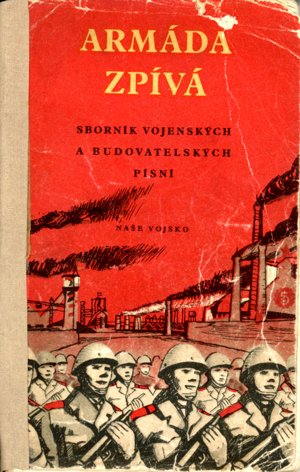
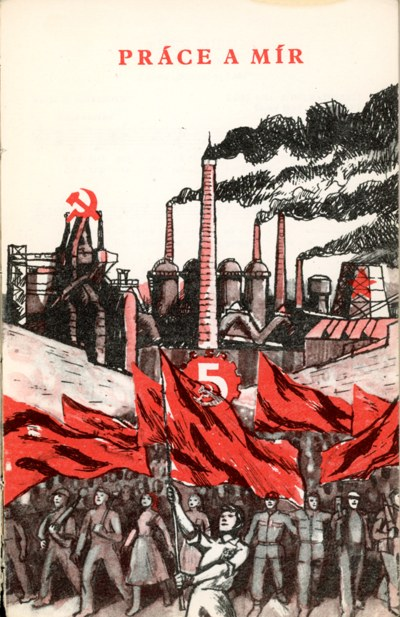

*Předmluva a motta ze zpěvníku Armáda zpívá: sborník 1–4hlasých vojenských a budovatelských písní českých, slovenských, sovětských a všech lidových demokracií, který vybral a sestavil Milan Horák (1922–1993) a vydalo nakladatelství Naše vojsko v roce 1951. Zpěvník ilustroval Jiří Mikula.*

<i>… A když jsme stanuli, znavení, ospalí, 
když tank odpočíval, letadlo i my, 
písničky májové, jarní jsme zpívali, 
v nich byla svoboda, radost a sny.</i> 
<small>Stanislav Wygodzki: Píseň vítězství</small>

<i>… A tak zpíváme, když se vtírá stesk, zpíváme, když je veselý den, zpěvem provázíme kamaráda, který odchází a s nímž se snad už neshledáme, zpěvem vítáme dobré zprávy z bojiště na východě, zpíváme pro útěchu a zpíváme z radosti, tak, jak lidé zpívají odedávna a budou zpívat, dokud budou lidmi. Není života bez zpěvu, jako není života bez slunce.</i> 
<small>Julius Fučík: Reportáž psaná na oprátce</small>

<i>… Hudebníci tančili a zpívali dlouho, až do třetí v noci. Gorkij znal mnoho neapolských písní a měl vždy hroznou radost, když slyšel známou. Tiše, aby nevyrušil zpěváky, nenápadně přistoupil ke mně, něžně se na mne dívaje. 
— A co vy, umíte hodně písní? zeptal se mne náhle. 
— Vůbec nezpívám a písní znám málo. 
Gorkij až odskočil. 
— To vy z přesvědčení nebo náhodou? 
— Spíš náhodou. V našem rodě se nezpívalo, přátelé také málo zpívali. 
Přerušil mne: 
— To je náhodou. Spisovatel nemůže nezpívat a neznat písně. Psát — to je nejen přemýšlet, nýbrž také zpívat.</i> 
<small>Vsevolod Ivanov: Setkání s Gorkým</small>

<i>… Naším cílem je tvořit revoluční hudbu, která by byla opravdu revoluční ve své podstatě a která by obstála před všemi uměleckými nároky.</i> 
<small>Vít Nejedlý</small>

<i>… „Co jste učinili k posílení míru? 
Kde jsou vaše písně, kantáty a symfonie, 
věnované boji za mír?“</i> 
<small>Z dopisu sovětských umělců hudebníkům Západu, červenec 1950</small>

V lidově demokratické armádě stala se píseň účinným nástrojem bojové a politické výchovy a spolu s literaturou a všemi ostatními prostředky ideové a politické propagace vede naše vojáky k socialistické kultuře.

Člověk zpívá, co žije na zemi. O čem a jak zpíval, to je napsáno v dějinách hudby. Kdo má chuť, ať se o tom široce poučí. Nás zajímají písně, které bojují: písně, které rostly z hněvu a vzpoury utlačovaných, písně, které splývaly s povelem k útoku a neméně i ty, které se rozjásaly po dosaženém vítězství. A stejně i ty, které zvučí jako dynama, bagry a traktory. Takové písně potřebuje člověk dneška, písně, které pomáhají „bojovat, stavět a žít“.

A taková je sovětská píseň.

Když na Všesvazovém sjezdu stachanovců v Kremlu v listopadu 1935 ukončilo dvoutisícové plenum své zasedání radostným „Pochodem veselých dětí“, zpívala jejich ústy celá sovětská země, tehdy už vyléčená z ran intervenční a občanské války, nová a silná, zvedající se na prahu druhé pětiletky k obrovskému rozmachu výstavby, úspěchů a síly.

Dva roky potom zpívala celá Moskva a brzo celý Sovětský svaz druhou Dunajevského písničku „Píseň o vlasti“. I ona byla odrazem štěstí a radosti, které si ve své zemi vybudoval svobodný sovětský člověk, a které si nedal vzít.

Velká vlastenecká válka byla pro sovětského člověka velkou zkouškou. Všichni šli do boje: lidé i písně. Národ prožíval osudové chvíle života a potřeboval umění pravdivé a silné. Písnička musila mít sílu zbraně. Skladatelé a hudebníci odcházeli za vojáky na frontu, aby na pochodech, v bitvách, ústupech a vítězném postupu prožívali celou hloubku toho, co prožívali krasnoarmějci. Píseň se stala nábojnicí síly, odvahy, učila družnosti a kázni, píseň byla spojkou mezi domovem a frontou, byla frontovým deníkem událostí. Každá fronta měla svůj orchestr a soubor. Zpívalo se skoro ve válečném ohni. Zpívalo se ve sklepích bojujícího Stalingradu, na palubě baltického loďstva, zpívali parašutisté na Krymu i partyzáni na Ukrajině. Píseň udržovala teplo domova v spoušti ničení. Ne náhodou stala se Kaťuša — laskavé dívčí jméno oblíbené hrdinky Isakovského vojenských písní — názvem hrozné zbraně sovětské armády.

Píseň spojovala frontu s hlubokým zápolím. Alexander Fadějev vypráví v „Mladé gardě“, jak komsomolci z Krasnodonu poslouchají tajně v rozhlasu Isakovského písničku „Kto ego znajet“ a jak je tato rodná píseň naplňuje radostí a dodává jim sílu k boji s nenáviděným nepřítelem.

Avšak s posledním výstřelem na frontě neztrácí sovětská píseň svou bojovou sílu. Zpívá o radosti nad koncem války a kdo viděl film „Pád Berlína“, vzpomene si v této souvislosti na jednu ze závěrečných scén filmu, kde ssutiny Reichstagu se mění v tisícihlavé jeviště radosti a zpěvu.

Ale zločin pokračuje. Fašismus ožil v imperialistické Americe, v Západním Německu a zuří na Koreji. Sovětská píseň bojuje dál. Bojuje za mír. Není to opět náhoda, že obě mírové hymny mládeže celého světa jsou písně sovětských skladatelů. Pražský Festival v roce 1946 si zvolil Novikovovu píseň za hymnu demokratické mládeže, účastníci Festivalu mládeže v Budapešti přijali v roce 1948 Muradeliho píseň jako oficiální hymnu Mezinárodního svazu studentstva. Sovětská píseň a vůbec sovětská hudba se stala důležitým organisujícím činitelem v boji za mír, v boji o demokracii a sjednocení všech pokrokových sil všech zemí. Stala se jedním z oněch duchovních článků, které nás spojují v pevném nerozlučném přátelství a bratrství s pracujícími lidově demokratických zemí a veškerým pokrokovým lidstvem. Sovětské písně znějí ve všech jazycích, na všech koncích světa, zpívají je národy všech ras.

Tyto dvě hlavní okolnosti — účinná bojovnost písně přímo na frontách občanské i Velké vlastenecké války a na druhé straně její neporazitelný optimismus a radostné sebevědomí, s nímž oslavuje práci a sjednocuje národy v boji za mír, tyto okolnosti byly organisačním záplanem při uspořádání armádního zpěvníku. Porazit nepřítele a zajistit mír — to je smysl práce a života všech pokrokových lidí. A to je taky úkol každé lidové armády.

 <small>Předěl oddílu Práce a mír, kresba Jiří Mikula</small>

Bylo radostné vybírat a střádat materiál. Ve zpěvníku najdete i naše písně a v skrovném výběru písničky všech lidových demokracií. Ty všechny jsou odrazem nových dějin, které nastoupilo lidově demokratické Československo, Bulharsko, Polsko, Albánie, Maďarsko, Rumunsko, Demokratická republika německá a lidově demokratická Čína.

Do sborníku jsem nezařadil národní písně všech jmenovaných zemí. Udělám to ve zvláštním svazku.

A teď už nezbývá než se dát do zpěvu. Při těchto písních zapomeneme na únavu po třicetikilometrovém pochodu, jimi budeme začínat své kulturní besedy a hodiny politické výchovy, zazní na cvičišti, na pochodu i v učebnách, v kulturních světnicích, při oddechu, za výcviku a na podiích Soutěže tvořivosti. Půjdou za vojáky do výcvikových táborů a do každé stanice pohraniční stráže.

A ať učí nenávisti i lásce. Nenávisti k těm, kteří kazí svět a nechtějí slyšet píseň míru. Lásce k těm, kteří ho svýma rukama stavějí a chrání.

<i>V Praze v prosinci 1950 Milan Horák</i>

*Na konci zpěvníku je ještě vzpomínka A. V. Alexandrova [Stalin nás učí rozumět písni](/state.phtml/soudruh_stalin_nas_uci_rozumet_pisni).*

## Písně ze zpěvníku na webu

[Avanti o popolo](/pisen.phtml/avanti_o_popolo), [Borodino](/pisen.phtml/borodino), [Brigádnický pochod](/pisen.phtml/brigadnicky_pochod_bulharsky), [Brigádnický pochod](/pisen.phtml/brigadnicky_pochod), [Cesty](/pisen.phtml/cesty), [Dělostřelecká](/pisen.phtml/delostrelecka), [Dnes prapor náš](/pisen.phtml/dnes_prapor_nas), [Do práce již](/pisen.phtml/do_prace_jiz), [Dubinuška](/pisen.phtml/dubinuska), [Dva sokoli](/pisen.phtml/dva_sokoli), [Ej, zelenými pláněmi](/pisen.phtml/ej_zelenymi_planemi), [Granát](/pisen.phtml/granat), [Havířská](/pisen.phtml/havirska), [Hej, ty pole širé](/pisen.phtml/hej_ty_pole_sire), [Hej rup! (rumunská brigádnická)](/pisen.phtml/hej_rup_rumunska), [Hej stalinovci](/pisen.phtml/hej_stalinovci), [Hej ty puško](/pisen.phtml/hej_ty_pusko), [Hlavu výš!](/pisen.phtml/hlavu_vys), [Hymna demokratické mládeže](/pisen.phtml/hymna_demokraticke_mladeze), [Hymna ELAS](/pisen.phtml/hymna_elas), [Hymna sovětského svazu](/pisen.phtml/hymna_sovetskeho_svazu), [Internacionála](/pisen.phtml/internacionala), [Jaro na frontě](/pisen.phtml/jaro_na_fronte), [Jde dál po Uralu Čapajeva voj](/pisen.phtml/jde_dal_po_uralu_capajeva_voj), [Jsou-li krásné mladé květy v máji](/pisen.phtml/jsou_li_krasne_mlade_kvety_v_maji), [Kalinka](/pisen.phtml/kalinka), [Kantáta o Stalinovi](/pisen.phtml/kantata_o_stalinovi), [Komsomolská](/pisen.phtml/komsomolska_solovjov_sedoj), [Krasnyj partizan](/pisen.phtml/krasnyj_partizan), [Ktož jsú boží bojovníci](/pisen.phtml/ktoz_jsu_bozi_bojovnici), [Kupředu, kupředu!](/pisen.phtml/kupredu_kupredu), [Kupředu, zpátky ni krok](/pisen.phtml/kupredu_zpatky_ni_krok), [Letecká](/pisen.phtml/letecka), [Lidová armáda](/pisen.phtml/lidova_armada), [Mladá píseň](/pisen.phtml/mlada_pisen), [My](/pisen.phtml/my), [My jsme vojáci naší republiky](/pisen.phtml/my_jsme_vojaci_nasi_republiky), [My s Leninem a Stalinem](/pisen.phtml/my_s_leninem_a_stalinem), [Na barykady](/pisen.phtml/na_barykady), [Na nebi západ zlát'](/pisen.phtml/na_nebi_zapad_zlat), [Na pochod!](/pisen.phtml/na_pochod), [Na pochod, mládeži](/pisen.phtml/na_pochod_mladezi), [Náš cieľ](/pisen.phtml/nas_ciel), [No passaran](/pisen.phtml/no_passaran), [Nová pieseň znie](/pisen.phtml/nova_piesen_znie), [Nový život](/pisen.phtml/novy_zivot), [O „Kaťuši“](/pisen.phtml/o_katusi), [Oj, ty stepi široká](/pisen.phtml/oj_ty_stepi_siroka), [Oj, vy závoje mlh](/pisen.phtml/oj_vy_zavoje_mlh), [Partyzánská](/pisen.phtml/partyzanska_hanus), [Partyzánská](/pisen.phtml/partyzanska), [Pevně, soudruzi, dál v budování](/pisen.phtml/pevne_soudruzi_dal_v_budovani), [Pieseň päťročnice](/pisen.phtml/piesen_patrocnice), [Pieseň pracujúcich](/pisen.phtml/piesen_pracujucich), [Píseň albánské armády](/pisen.phtml/pisen_albanske_armady), [Píseň brigády](/pisen.phtml/pisen_brigady), [Píseň frontového šoféra](/pisen.phtml/pisen_frontoveho_sofera), [Píseň jednoty](/pisen.phtml/pisen_jednoty), [Píseň míru](/pisen.phtml/pisen_miru), [Píseň mladých kozáků](/pisen.phtml/pisen_mladych_kozaku), [Píseň o „tačance“](/pisen.phtml/pisen_o_tacance), [Píseň o bratrství](/pisen.phtml/pisen_o_bratrstvi), [Píseň o Leninovi](/pisen.phtml/pisen_o_leninovi), [Píseň o pátém pluku](/pisen.phtml/pisen_o_patem_pluku), [Píseň o rozhodném kroku](/pisen.phtml/pisen_o_rozhodnem_kroku), [Píseň o Stalinovi](/pisen.phtml/pisen_o_stalinovi), [Píseň o Ščorsovi](/pisen.phtml/pisen_o_scorsovi), [Píseň o vlasti](/pisen.phtml/pisen_o_vlasti), [Píseň o Vorošilovi](/pisen.phtml/pisen_o_vorosilovi), [Píseň práce](/pisen.phtml/pisen_prace), [Píseň sjednocených stran](/pisen.phtml/pisen_sjednocenych_stran), [Píseň smělých](/pisen.phtml/pisen_smelych), [Píseň svobody](/pisen.phtml/pisen_svobody_albanska), [Píseň úderníků](/pisen.phtml/pisen_uderniku), [Píseň z fronty o Stalinovi](/pisen.phtml/pisen_z_fronty_o_stalinovi), [Pochod brigády](/pisen.phtml/pochod_brigady), [Pochod jednotné dělnické fronty](/pisen.phtml/pochod_jednotne_delnicke_fronty), [Pochod Klementa Gottwalda](/pisen.phtml/pochod_klementa_gottwalda), [Pochod Komsomolu Rudého praporu](/pisen.phtml/pochod_komsomolu_rudeho_praporu), [Pochod lidové gardy](/pisen.phtml/pochod_lidove_gardy), [Pochod první úderné brigády](/pisen.phtml/pochod_prvni_uderne_brigady), [Pochod rudých námořníků](/pisen.phtml/pochod_rudych_namorniku), [Pochod veselých dětí](/pisen.phtml/pochod_veselych_deti), [Pod prapory](/pisen.phtml/pod_prapory), [Poďme, chlapci aj dievčatá!](/pisen.phtml/podme_chlapci_aj_dievcata), [Políčko, pole](/pisen.phtml/policko_pole), [Přísaha](/pisen.phtml/prisaha), [Radosť z práce](/pisen.phtml/radost_z_prace), [Republiko!](/pisen.phtml/republiko), [Rodná země](/pisen.phtml/rodna_zeme), [Rudá armáda](/pisen.phtml/ruda_armada), [Rudý prapor](/pisen.phtml/rudy_prapor), [Rudý traktorista](/pisen.phtml/rudy_traktorista), [Septemvrijci](/pisen.phtml/septemvrijci), [Setkání Buďonného s kozáky](/pisen.phtml/setkani_budonneho_s_kozaky), [Sibiřan](/pisen.phtml/sibiran), [Směr Praha](/pisen.phtml/smer_praha), [Soudruzi, my jdem' s Vámi](/pisen.phtml/soudruzi_my_jdem_s_vami), [Soudruzi, vzhůru!](/pisen.phtml/soudruzi_vzhuru), [Sportovní pochod](/pisen.phtml/sportovni_pochod), [Stavíme nový svět](/pisen.phtml/stavime_novy_svet_pauer), [Svatá válka](/pisen.phtml/svata_valka), [Tam, kde Orel rozpjal křídla](/pisen.phtml/tam_kde_orel_rozpjal_kridla), [Tankista Vasja](/pisen.phtml/tankista_vasja), [Tažní ptáci](/pisen.phtml/tazni_ptaci), [Tři tankisti](/pisen.phtml/tri_tankisti), [U studánky](/pisen.phtml/u_studanky), [Usměvavá zem](/pisen.phtml/usmevava_zem), [Už vyšlo slnko](/pisen.phtml/uz_vyslo_slnko), [Údernická](/pisen.phtml/udernicka), [V boj za rodnou zem](/pisen.phtml/v_boj_za_rodnou_zem), [V širou dál](/pisen.phtml/v_sirou_dal), [Varjag](/pisen.phtml/varjag), [Varšavjanka](/pisen.phtml/varsavjanka), [Válka! Válka!](/pisen.phtml/valka_valka), [Veselá harmonika](/pisen.phtml/vesela_harmonika), [Vlajka mládí](/pisen.phtml/vlajka_mladi), [Voják úderník](/pisen.phtml/vojak_udernik), [Vpřed směle soudruzi spějme](/pisen.phtml/vpred_smele_soudruzi_spejme), [Vzpomínka z fronty](/pisen.phtml/vzpominka_z_fronty), [Za hvězdou jitřní](/pisen.phtml/za_hvezdou_jitrni), [Zahrádky, sádky](/pisen.phtml/zahradky_sadky), [Zdravíme vítězství](/pisen.phtml/zdravime_vitezstvi), [Zpátky ni krok](/pisen.phtml/zpatky_ni_krok), [Zpíváme si o překrásné zemi](/pisen.phtml/zpivame_si_o_prekrasne_zemi).
