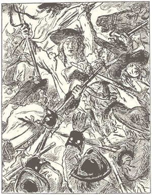
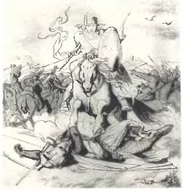
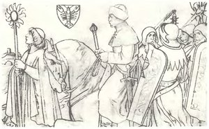
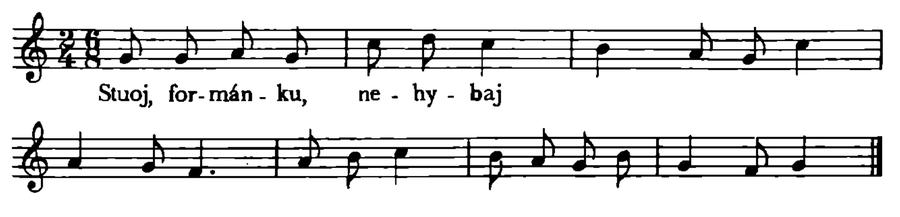
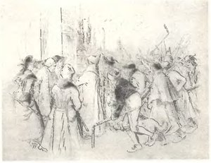
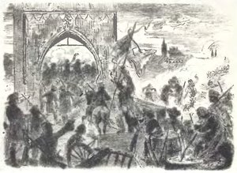

*Předmluva ke Českému revolučnímu zpěvníku: vybrané revoluční, lidové, dělnické a budovatelské písně od dob nejstarších až po dobu současnou, který sestavili Vladimír Karbusický a Jaroslav Vanický a vydalo Státní nakladatelství krásné literatury, hudby a umění v Praze roku 1953; zpěvník provázejí kresby Mikoláše Alše.*

 <small>Mikoláš Aleš: Psohlavci (Boj Chodů)</small>

<i>Říkáme našim mládežnickým souborům, že stará píseň není jen krásná, nýbrž také plně životná, jestliže se na ni ovšem podíváme skrze písně nové; bez pochopení těchto nových písní nelze pochopit ani písně staré. Pochopit novou píseň znamená však pochopit život lidu, o kterém zpívá. 
Josef Stanislav.</i>

## Předmluva

Pomalu, jako tok velké řeky plynuly řady dlouhých let a staletí, po která lid naší země toužil po svobodě, štěstí a míru. Znovu a znovu vždy zahořela jeho rudá krev v těžkých bojích s těmi, kdož jej poutali krutým bříměm chudoby, hladu a otroctví. Byla v dějinách tohoto lidu vleklá údobí únavy a vyčerpání sil a zdálo se, jako by pro vždy ochabla jeho energie a vůle nastoupit boj. Ale vždy se ukázalo, že klid byl jen dobou zrání dalších revolučních výbuchů, které nutily vládnoucí třídy k ústupkům a hýbaly dějinami směrem k pokroku.

Dnes před námi leží obrovská epocha třídních bojů selského lidu proti feudálním pánům, městské chudiny proti patricijům, dělníků proti kapitalistům. Od dob husitské revoluce až po náš čas zápasil lid neustále o své štěstí, svobodu práce a mír. A po celý ten tok dějin provázela lid v jeho bojích *píseň*.

Píseň dovede být v rukou nepřítele lidu opiem, prostředkem k ohlupení, duševnímu zotročení a vykořistění člověka. Mysticko-náboženský zpěv v rukou středověké církve a pozdější jesuitské reakce, smyslně kupletní píseň měšťáctva, sentimentální a vulgárně „lidový“ šlágrový brak za nadvlády novodobé buržoasie jsou toho výmluvnými doklady.

Píseň však může být zvednuta na úroveň zbraně; píseň v rukou revolučních mladých sil společnosti dovede být spolubojovnicí k ztečení nebes, dovede rozbušit železným krokem mas celou zemi. Toho svědectvím je bojová píseň husitů, píseň selských mas v dobách roboty, píseň revolučně demokratických sil obrození a konečně píseň dělnická, která přešla v masovou, budovatelskou píseň naší osvobozené vlasti.

Zachytit v nejtypičtějších ukázkách revoluční píseň v českých dějinách a přiblížit ji souborům a veřejnosti je cílem tohoto zpěvníku.

*

Mocná revoluční vlna, která se sbírala v hlubinách lidu před vypuknutím husitské revoluce, přinesla s sebou i první formy českého revolučního zpěvu. Do té doby nemáme dokladů revolučních písní; přesto však o aktivitě lidu svědčí lidové písně duchovní, kterých si lid vydobyl přesto, že církev těmto písním nepřála. Je to především první dochovaná lidová duchovní píseň vůbec, „[HOSPODINE POMILUJ NY](/pisen.phtml/hospodine_pomiluj_ny)“, jež souvisí s prvotní, nižšímu stupni feudalisace odpovídající slovanskou liturgií. Zdá se, že byla přiřčena sv. Vojtěchovi v době, kdy se shledávaly různé památky na tohoto patrona (asi po roce 1125). Lid tuto píseň zpíval v dobách stále rostoucího vykořisťování, kdy mizely poslední zbytky rodového zřízení na úkor utužujících se forem feudálního řádu. Proto v této době rostoucích rozbrojů vnitřních i vnějších lid lpěl na své písni, jejíž slova byla prosbou velmi reálnou: *dej nám všem žizň a mír v zemi*. A česká vojska zpívala tuto píseň v bojích s nepřítelem, napadajícím naše země.

V dobách braniborské okupace se lid chopil melodicky rozvrásněné, vzpínající se žaloby bídy — písně „[SVATÝ VÁCLAVE](/pisen.phtml/svaty_vaclave)“. Braniborská okupace po prvé odhalila hnisající rány třídně se diferencující feudální společnosti. Podle slov letopisů krále Otakara k roku 1281 požívala tehdy hladová chudina chcíplé psy a jiné zdechliny; pražská chudina, jež neměla přístřeší ani žádného oděvu, zalézala v zimě za tuhých mrazů do hnoje, který se tehdy kydal z koníren na ulice. Vzepnuté kvartové vzlyky písně k sv. Václavu a konečně slova

<i>utěš smutné, otžeň vše zlé</i>

byla opět hlubokým protestem chudiny proti bídě a národní porobě. Teprve za husitských bouří se stala tato píseň neaktuální jako píseň konservativní strany.

 <small>Mikoláš Aleš: Smysly (Zrak)</small>

Zvolna však zrály síly k prvnímu velkému revolučnímu výbuchu proti feudální reakci — k husitské revoluci. Hněv zchudlých zemanů, drcených měšťanů a řemeslníků, zuboženého venkovského lidu a bědné městské chudiny — hněv všech těchto tříd se soustřeďoval proti nejmocnější opoře feudální vykořisťovatelské mašinerie — církvi.

Ve společnosti to začíná vřít. Vzniká půda pro nový zjev v dějinách písňové kultury, pro tvorbu satirické časové písně a politického popěvku. — Jednou z prvých časových písní je píseň prozrazující svůj původ v kruzích inteligence pražského učení „[PRAVDO MILÁ](/pisen.phtml/pisen_o_pravde)“. Je to skladba alegorická. Pravda bloudí po světě, u všech stavů je odbývána, až opustí zklamána svět a odchází znovu do nebe. Svým líčením zejména poměrů v církvi hrála pokrokovou úlohu. Melodie je lidová, světská.

Zostřující se třídní rozpory však vzbudily k životu písně, jež šly mnohem dále než tato krotká píseň o Pravdě. Vyrojila se celá řada t. zv. „hančivých písní“, které, jak praví staří letopisci, budily „velkou nechuť mezi lidmi“. Podnětem k popěvkům, trhajícím autoritu církve, bylo zejména spálení knih Viklifových biskupem Zbyňkem Zajícem roku 1410. Rozhněvaní studenti složili na biskupa popěvek začínající:

<i>Zajíc biskup abeceda 
spálil knihy, a nevěda 
co jest v nich napsáno…</i>

Popěvek prý podnítil v lidu velikou „búřku a ruoznice“. Ještě po letech, roku 1432 vzpomínal v rozhořčení pisatel Invectio contra Hussitas, kterak tento politický popěvek vnikal do lidu a uváděl jej do pohybu: „Písničku ve sprosté češtině udělali, kterou luza po ulicích a náměstích jako psi vzteklí za kluky se rozběhnuvší o knihách hanlivě spálených do omrzení zpívala: Zbyněk kniehy spálil.“

„Hančivých písní“ bylo v době nazrávání husitské revoluce velké množství. Proti dryáčnickému prodávání odpustků se na příklad zpívalo:

<i>Bubeník, ten je nosí u voze, 
raduje se každé koze, 
ktož mu ovci, krávu dá, 
všecky římské odpustky má, 
pekla i propasti.</i>

Jiná píseň bouřila i v národním duchu proti Římu:

<i>Čechové pomněte, 
svým dětem to pravte, 
kacieřem nebyl Čech, 
ani ještě v těchto dnech 
móž nalezen býti.</i>

Vyplývá již z přirozené psychologické působivosti revolučního popěvku, že má zpravidla nějakou známou, „obecnou“ notu. Nejrozšířenější obecnou notou byla melodie, která se nám zachovala k písni „[Ó SVOLÁNÍ KONSTANTSKÉ](/pisen.phtml/o_svolanie_konstanske)“, na níž se pravděpodobně zpívaly i shora uvedené písně s pětiveršovou strofickou stavbou. Píseň „Ó svolání Konstantské“ je krásným svědectvím toho, jak lid reagoval na zprávu o upálení Mistra Jana.

„Hančivé písně“ pomáhaly revolucionovat nejširší masy. Politický popěvek rázem strhává autoritu napadené strany, pomáhá rozrážet tábory. Tuto funkci měl popěvek v každé politicky vzrušené době. Vzpomeňme písní a popěvků roku 1848, popěvků za vzepjaté vlny lidového odporu proti Vídni v letech šedesátých, konečně popěvků dělnických v letech devadesátých, v době po první světové válce a v květnové revoluci. Se svým známým nápěvem vniká popěvek rychle do nejširších mas a je jednou z nejúčinnějších ideologických zbraní revolučních sil.

Rozvášnění lidu vznikajícími popěvky v době před vypuknutím husitských bouří bylo tak veliké, že král Václav IV. všechno takové zpívání zakázal. Zákazy však nebyly nic platny. Časová městská píseň ústila již v revoluční stržení lidu a pouštěla do chodu jeho kvasící mladé síly. Krásným příkladem je píseň „SLYŠTE RYTIEŘI BOŽÍ“, která je již i melodicky předchůdkyní revoluční hymny „Ktož jsú boží bojovníci“. Píseň vyzývá k boji s Antikristem — církevně feudální mocí. Nápěv je vážný, vyjadřující věrně citovou hloubku lidového hněvu. Výstižně o něm praví Zdeněk Nejedlý, že „postupuje mohutně kupředu, jako by drtiti chtěl nepřátele pravdy Kristovy… Hlásí se v něm už nový duch, starší i této době v širším rozsahu ještě neznámý, duch božích bojovníků.“

Revoluční ideologie měla tehdy nutně formu náboženskou; na poli nábožensky obrazné mluvy se mohla uplatnit a působit. Vážný prvotně církevní asketismus byl nutnou ideologickou zbraní. O tomto momentu platí skvělá Engelsova slova z práce o německé selské válce: „Tato asketická přísnost mravů, tento požadavek odřeknutí se všech požitků a zábav staví jednak proti vládnoucím třídám zásadu spartánské rovnosti, jednak je nutným přechodným stupněm, bez něhož se nejnižší vrstva společnosti nikdy nemůže dostat do pohybu…“\* „Vskutku mohlo jen násilné vzepětí, náhlé odřeknutí se celého obvyklého způsobu života uvést do pohybu selské pokolení, roztříštěné, řídce rozseté a vyrostlé v slepém poddanství…“\* Tak lze porozumět i požadavku kladenému v počátcích husitské revoluce, aby lid opouštěl a pálil svá obydlí a stahoval se na hory, kde kyne jediná spása. Tábory lidu na horách pomáhaly organisovat roztříštěný lid. Kazatelé ukovávali v jednotu jeho myšlenky a vůli. Příznačné je, že vznikaly i *písně*, jež vyzývaly lid k opuštění světa a setrvání na horách. Takové byly písně „Věrní se bohu radujte“, „Radujme se dočekavše“ s lidovým vážným nápěvem a pevně zformovaným rytmem. Třetí dochovaná píseň tohoto druhu až překvapuje slokami s konkretně vyjádřeným sociálním obsahem. Zpupní kněží by prý nejraději sjednali u boha,

<i>by chudí nikdá nejedli, 
nic pijíc, nazí chodili, 
den s nocí nespíce, 
než na pány vždy dělali, 
bez přestánie jim dávali, 
dosti by neměli.</i>

Panské ujařmení lidu není z boha, je útiskem naduté církve:

<i>Dadiet jej v těžké roboty, 
jenž nikdy nejsou z boha ty, 
ni z koho dobrého.</i>

<i>Takt jest úzkost nebožátkóm 
po všech zemiech, zvláště Čechóm, 
pro kněžstvo naduté…</i>

Nápěv této písně se bohužel nezachoval.

<small>\* B. Engels, Německá selská válka, Praha 1950, str. 53.</small>

Chiliastické nálady byly brzo překonány nutností bránit vydobyté revoluční vymoženosti. Lid buduje *město* jako vzor odolné pevnosti této doby a svobodného způsobu řemeslné výroby: *Tábor*. V tomto novém městě si lid živelně vytyčuje prvotně komunistické zásady života jako jedinou spravedlivou formu společenského soužití svobodných lidí. A zároveň vytváří vojenskou obranu vydobyté svobody, vytváří ve středověku nevídaný druh lidového vojska. Zemané druhu Žižkova mu dodávají zásady nové vojenské techniky, nadšení člověka pak přispívá k vytyčení pevné revoluční kázně. Žižkův vojenský řád, tento nádherný kodex revoluční armády, se pak vtěluje do nejproslulejší bojové písně husitů — „[KTOŽ JSÚ BOŽÍ BOJOVNÍCI](/pisen.phtml/ktoz_jsu_bozi_bojovnici)“. Osvobozený lid v Žižkově vojsku poznal, co znamená „ochutnat svou zbraň“ v boji proti vnitřním i vnějším nepřátelům. Ještě po staletí nevymizela vzpomínka na tuto píseň a znovu se objevila za národního obrození, aby zahořela v apotheose slávy a svobody lidu — ve Smetanově Libuši, Táboru a Blaníku. „Na podkladě této melodie (tohoto husitského principu) se vyvine *vzkříšení národa českého, budoucí štěstí a sláva*“ — podtrhuje Smetana.

 <small>Mikoláš Aleš: Jan Žižka z Trocnova</small>

Píseň „Ktož jsú boží bojovníci“ přináší zcela nové světy i po stránce melodické. Začátek je jakoby melodickým zobecněním vysokého tónu polnice i s jejím dozněním v pokleslém nápěvu: „a zákona jeho“. Další část o prosbě k bohu zase zobecňuje výraz modlitby, tedy prvek nebojovný, niterný. To v ní skvěle vystihl Smetana, který s touto částí pracuje jako s lyrickým thematem kontrastujícím k prvému. Poslední část versu „Že konečně s ním…“ je jakýmsi náhlým vytržením ze zamyšlení, znovuobrácením k rozhodnému boji. (Je to tedy podobný obrat, jaký je i v novodobé Marseillaise, když po nápěvu, který upadl do mollové tóniny, následuje náhlé vzchopení: „Aux armes, citoyens…“ — „Do zbraně, občané…“ Uvědomíme-li si tuto vzdálenou podobnost, tím spíše nám vynikne již novověký revoluční ráz husitské písně.) Rozložený kvintakord f1 a1 a1 c2 a1 a1 f1 opět zobecňuje trubačskou výzvu k boji. Repetice je pak již rozvášněným, neklidným zpěvem boje, pohybujícím se ve velkých rozlohách melodických, jež mu dodávají sugestivního rozmachu. Terciový sestup a1 c2 c2 a1 a1 f1 f1 d1 opět zobecňuje zvuk válečných fanfár. Konečně i neklidný střídavě vzestupný a sestupný rytmus jen dokresluje neústupnost a odhodlání božích bojovníků. Je tedy tato píseň příkladem, jak se do realistického melodického obrazu vtělují reálné životní intonace. Jen pro tuto spojitost se životem mohla rozplameňovat bojovníky a zahánět nepřítele. Proto z této melodie mohl ještě po staletích Bedřich Smetana vytvořit skladbu líčící, jak píše v programu Mé vlasti, „pevnou vůli, vítězné boje, stálost a vytrvalost a tvrdošíjnou neústupnost“.

Táborská obec byla rozdělena na obec pracující doma a v poli válečném. Píseň „[DIETKY V HROMADU SE SENDĚME](/pisen.phtml/dietky_v_hromadu_se_sendeme)“ je krásným příkladem skutečně lidsky prožívané radosti obce doma pracující nad návratem bratří z pole. Píseň je překvapující svým živým výrazem radosti, i když je vyjádřena soudobou řečí v církevní tónině. Thema první části písně je ve zcela novodobém duchu variováno v melodických krocích. Druhá část v zušlechtěném tvaru stylisuje téměř tanečně znějící třídobý rytmus a tak melodickým obrazem věrně líčí plesání lidu. I velký rozsah melodie je obrazem jeho jásotu. Konečně kolísání nápěvu mezi lydickou tóninou a jonickou dur jen dokresluje ráz táborového veselí, které nepřekračuje míru a je si stále vědomo vyššího poslání a vážnosti revoluční věci. Vyhýbá se upadnutí do světského tanečního rytmu a — tehdy ještě vulgárně znějící — durovosti.

Také hnutí městské chudiny mělo své písně. Zachovala se nám především nádherná píseň z roku 1419 „[POVSTAŇ, POVSTAŇ VELIKÉ MĚSTO PRAŽSKÉ](/pisen.phtml/povstan_povstan_velike_mesto_prazske)“. Je to lidový nápěv a přitom vážný, ve frygické tónině a v jakémsi pochodovém živém rytmu. I intonace řeči je tu vyjádřena, zvlášť v začátku druhé části: nápěv se tu náhle vznese o celou nonu výš a velmi dobře vyjadřuje výraz slov: „proti tomu králi Babylonskému…“ Tímto králem se myslil proradný král Zikmund.

Výběr těchto husitských písní ukazuje, jak se do zpěvu osvobozeného lidu dostávaly reálné životní intonace, pro něž jsou dodnes tyto melodie životné. Husitský zpěv byl nejslavnější epochou českého revolučního zpěvu. Husité povýšili píseň na úroveň bojové zbraně. Píseň — spolubojovník lidu — tak vkročila definitivně do českých dějin jako mocný ideový činitel. Tento význam bezprostřední bojové funkce písně pak vzkřísilo znovu zejména hnutí dělnické, které dovedlo revoluční píseň opět k novým výšinám a dobylo jí nehynoucí místo v boji o nový svět.

Pohusitská epocha do Bílé Hory nepřinesla dokumentů revolučního zpěvu. Byla to smutná doba pozvolného odbourávání někdejších revolučních vymožeností a upevňování posic feudální moci. Výrobní síly země upadají, lid je stále více zotročován, práva měst stále více oklešťována. Jednota bratrská, kdysi ve svých počátcích pánům nebezpečná, se po stránce společenské mění v organisaci tichého odevzdání do vůle osudu. Lid nemá též nižádného prospěchu ze světla renesance, přijímaného v úzkém kruhu inteligence.

Písňová kultura se v té době pohroužila do oblasti čistě nábožensko-humanitní. Literátská bratrstva proměňují zpěv v záležitost společenského vzdělání a církevního kultu.

Lid byl postupně svazován tak, že v osudných chvílích nástupu cizácké reakce nebyl schopen vzít věc národa do svých rukou po vzoru husitských předků.

Na poli písňovém jen řídce dochované náznaky ukazují na doutnající revoluční jiskérky v lidových masách. Až do nové doby se na příklad zachovala píseň o lsti Bočka z Kunštátu „[BYL JEST V KUNŠTÁTU](/pisen.phtml/byl_jest_v_kunstate)“, ve které lid zřejmě se zálibou zpíval o břichopasných mniších od 16. až do minulého století. Zajímavý je též textový zlomek písně ze 16. století „STUOJ, FORMÁNKU, NEHÝBAJ“, v jejíž melodii můžeme pozorovat již některé rysy typické pro pozdější písně zbojnické:\*

<small>\* Ot. Hostinský: 36 nápěvů světských písní lidových ze XVI. století, nápěv 31.</small>

V poslední době soustavnějším studiem našeho historického materiálu se objevují nové písně, zvláště z tohoto období, které nám dokreslují těžké životní poměry a podmínky našeho lidu na venkově. „[PÍSEŇ ČESKÝCH SEDLÁKŮ](/pisen.phtml/pisen_ceskych_sedlaku)“ a „[HONÁCKÁ](/pisen.phtml/honacka)“ z rukopisného sborníku Jiřího Košetického, který pochází z konce XVII. století, a píseň „[ŽÁDNÝ ČLOVĚK NEUVĚŘÍ](/pisen.phtml/zadny_clovek_neuveri)“ z rukopisné guberniální sbírky z roku 1819 jsou krutou obžalobou nelidského feudálního útlaku.

 <small>Mikoláš Aleš: Z bouří selských</small>

Ani v tomto údobí předbělohorském nezanikla v podvědomí lidu vzpomínka na husitské bojovníky v čele s Žižkou. Nic nepomáhaly posměšné jesuitské písničky na Žižku, kterými se reakce po Bílé Hoře snažila tyto vzpomínky vykořenit. Vášnivě bojovná a husitsky vážná melodie selského lidu „[KDE JE JAN ŽIŽKA](/pisen.phtml/kde_je_jan_zizka)“ s blanickou otázkou „už je čas“ je toho nejskvělejším příkladem. Proto se tak intensivně vynořila vzpomínka na Tábority za vzryvu revoluční vlny roku 1848, proto jí tak zaplanulo mnoho písní tohoto rušného léta. Ne náhodou se ozývá i v Kolárově-Smetanově písni „[VÁLKA! VÁLKA!](/pisen.phtml/valka_valka)“

Venkovský lid, který si nesčetnými selskými bouřemi dobýval krok za krokem zrušení roboty, vytvořil též četné bojové písně. „PÁNI — GROBIÁNI“ — tak v nich často jmenoval své utiskovatele. Robotní píseň o pánech-grobiánech na notu dnes známou k písni „Na tom pražským mostě“ byla tehdy, jak se zdá, hojně rozšířena a lokalisována v Čechách i na Moravě. Proto se nápěv vynořil v tolika protipanských revolučních popěvcích z roku 1848 (i dvě Havlíčkovy písně jej mají) a v popěvcích dělnických na tuto notu. Není divu, že mezi dělnictvem zlidověla na příklad tato sloka lidově anarchistické písně z 80tých let:

<i>Dejte pozor, páni, 
zatočíme s vámi, 
až jen jednou 
rudý prapor 
zavlaje nad námi!</i>

V Čechách posílal lid pány v písni „[TI SEDLÁCI UBOZÍ](/pisen.phtml/ti_sedlaci_ubozi)“ k čertu a sliboval jim provaz. Na východě, kde skýtaly útočiště hory, vyrostly krásné květy bojové písňové poesie zbojnické. Svérázná melodika těchto písní jako by byla přetavením jásavého chlapského výkřiku nabyté volnosti na horách a odrazu tohoto výkřiku od lesů až hluboko do údolí, k sluchu nenáviděných pánů.

Novou etapu v revolučním zpěvu znamenal nástup obrozeneckého měšťanstva, především jeho revolučně demokratických sil. Jako mladá třída společnosti soustřeďovalo obrozenské měšťanstvo kolem sebe všechny síly národa a zvedlo jako mluvčí lidu vysoko prapor demokratických svobod.

 <small>Mikoláš Aleš: Rok 1848</small>

Uvědomění lidu bylo burcováno množstvím vlasteneckých písní. Velikou úlohu hrály zejména lyrická „KDE DOMOV MŮJ?“ a bojovná „[HEJ, SLOVANÉ](/pisen.phtml/hej_slovane)“. Revoluční rok 1848 pak odhalil i revolučně demokratické křídlo obrozenské společnosti, které tehdy vážně prosazovalo republikánskou ideu. Dosud nebylo vyzvednuto a zhodnoceno toto republikánské myšlení našich demokratů. Bylo ututláno buržoasní historiografií, ač ve skutečnosti mělo velký vliv do budoucna, zejména na pozdější vývoj dělnického hnutí. Vždyť samo toto republikánské myšlení s prvky utopického socialismu bylo vyvoláno prvým pohybem v českém proletariátu. Českému dělnickému hnutí pak vůbec předalo hesla francouzské revoluce, předalo mu Marseillaisu i jiné „písně svobody“, jak je jmenuje J. B. Pecka, když vzpomíná na jejich zpěv při oslavě vyhlášení pařížské Komuny roku 1871. Měšťáctvo velmi rychle zapomnělo na revoluční písně roku 1848 a ignorovalo je ve vydávaných zpěvnících. Nezapomínalo však na ně dělnictvo, které mnohé z nich uchovávalo v paměti (jako na příklad „Vstává národ“).

Z republikánských písní roku 1848 jsou zde uvedeny pozoruhodné „[VE JARMU, CO TAK DLOUHO HYNE](/pisen.phtml/ve_jarmu_co_tak_dlouho_hyne)“ a „[HEJ, ČEŠI, SRBOVÉ, SLOVÁCI](/pisen.phtml/hej_cesi_srbove_slovaci)“ (na stejnou melodii), jež končí požadavkem provolání „červené republiky“.

Naše dělnické hnutí navazovalo v písňové kultuře organicky na písně obrozenecké společnosti. V sedmdesátých letech, kdy se hnutí osamostatňuje a vyprošťuje z vleku buržoasie, začíná se distancovat též od písní měšťáctva. Tvoří na jejich melodie své textové verse s novým sociálním obsahem. Při vytváření vlastního písňového fondu mu mocným příkladem pomáhá také německá píseň dělnická. Část Herweglovy písně „Arbeiterlied“ se stala v překladu Leopolda Kochmanna první bojovou písní našeho dělnictva:

<i>Muži práce, probuď se, 
poznej sílu svoji! 
Chce-li silné rámě tvé, 
všechna kola stojí!</i>

Roku 1872 již tuto píseň zpívali „trhani“ na stavbě trati jako svou bojovou stávkovou píseň.

Těžisko revolučního boje se od sedmdesátých let přesouvá na bedra dělnické třídy, neboť měšťanstvo začalo vztyčený prapor demokratických svobod zrazovat a přecházelo stále zřetelněji na stranu reakce. Mnozí průkopníci socialismu se stali též skladateli prvních dělnických písní. Je to především slévač a tkadlec *Josef Boleslav Pecka-Strahovský* (1849—1896), výbušná a snivá povaha, jehož písně těžce bušily do zlořádů společnosti ve zvlášť obrazné dikci. Dále to byl *Norbert Zoula* (1854—1886), člověk neobyčejného srdce a romanticky zanícené mysli, který dal dělnickému hnutí jednu z nejryzejších písní. Další z průkopníků, malostranský krupař *Leopold Kochmann* (1845—1919), člověk s duší lidového hloubače, tvořil písně plné přesvědčujícího ohně, zaníceného poznáním socialistické pravdy. Konečně tu byl *F. J. Hlaváček* (1853—1937), uhlokop, bystrý a pohotový básník, tvůrce české verse „[PÍSNĚ PRÁCE](/pisen.phtml/pisen_prace)“, *T. J. Jiroušek* a j.

Zpěv byl našim průkopníkům zbraní, útěchou, povzbuzením, součástí agitační práce. Ve slovech písně, jak vzpomíná Josef Rezler, „jako by si byl každý sám řečníkem, který mluví o odplatě, oči nám všem plály, vložili jsme vše do zpěvu, svůj smutek nad vlastním údělem i mohutnost nespočetných našich řad — a rozcházeli jsme se s novými nadějemi v srdci, očištěni jaksi od kalu, kam nás uvrhla a kde nás chtěla míti kapitalistická společnost.“

Význam socialistické revoluční písně byl veliký. Když byli průkopníci v lednu 1882 souzeni v inscenovaném procesu, kladla jim obžaloba za jednu z největších vin skládání a šíření socialistických písní, které „obzvláště pojmy právní o vlastnictví rozviklati hleděly“.

Po založení sociálně demokratické strany roku 1878 vstoupilo naše dělnické hnutí do svého heroického údobí bojů. Výstižně tato léta charakterisoval Norbert Zoula: „Nyní nastal v hnutí teprve pravý život… Policie zatýkala, soudci odsuzovali a socialisté — agitovali… Zdálo se, že v socialistickém dělníku českém opět probudil se duch chrabrých bojovníků Tábora“. V této době rozvinuli průkopníci socialismu velikou agitační činnost, v níž písně hrály obrovskou úlohu. Z let 1878—1882 pochází též největší množství písní našich průkopníků.

V těchto letech též naši průkopníci v čele s *Ladislavem Zápotockým a J. B. Peckou* vysoko oceňovali význam pařížské Komuny jako praktického příkladu uskutečnitelnosti sociální revoluce. Jejím krvavým potlačením se nedali zmást; věřili, že skutečnost Komuny je znamením blížící se sociální revoluce všesvětové, která může přijít za nějakých 10 až 20 let. Komuna proto figuruje v mnoha dělnických revolučních písních jako cíl boje; dělníci v nich též přísahali pomstu vrahům pařížských proletářů.

Také ruské nihilistické hnutí sledovali průkopníci s nadšením jako příznak blížící se světové sociální revoluce. Proto zpívali též bouřlivou píseň o hrdé řeči revolucionářky Bardiny před soudem roku 1877, o Věře Zasuličové, která podnikla nebezpečný atentát na carského policejního psa Trepova, o smrti jeho nástupce, krvavého Mezenceva (1878), proto slibovali pomstu vrahům roku 1879 zavražděného nihilisty Kovalského. Komuna opět v uvedené písni stojí jako cíl revolučního boje.

Zpěv písní byl nedílnou součástí všech tajných schůzí. Píseň hromadila třaskaviny revoluční energie v probouzející se dělnické třídě. Proto ji neumlčela ani persekuce hnutí v letech osmdesátých. Ba naopak, socialistická píseň tím hlouběji pronikala do mas; vznikaly již i lidové dělnické písně a popěvky. V devadesátých letech, uvolněna slavným 1. májem 1890, rozpjala dělnická píseň křídla k novým výšinám.

Vystoupení dělnické třídy v devadesátých letech přineslo nové jaro celé české společnosti; proti zatuchlému řádu se bouří i inteligence, začíná to hýbat i lidem venkovským. Dělníci přijímají revoluční píseň Omladiny, podchycují popěvek venkovské chudiny. Okruh skladatelů dělnických písní se rozšiřuje, počet vytvořených písní již jde do set.

Leč brzo se připlížil do dělnického hnutí nebezpečný nepřítel — oportunismus a zbabělý reformismus sociální demokracie. Nespokojenost vedla proto mnohé části dělnictva k anarchismu a k hnutí anarchistickému se znenáhla přesouvá jeho revoluční energie. Z tohoto hnutí nám již vzešly první písně, které jsou přechodem k žánru písně masové.

Buržoasie již dávno odhodila kdysi vztyčený revoluční prapor; v oblasti písňové kultury zapomněla již na vlastenecké písně, jimiž kdysi vedla národ k svobodě a nyní začala korumpovat lid záplavou otupujícího šlágrového braku. Dělnická revoluční píseň se stala jediným shromaždištěm zdravé tvůrčí energie lidu, pomáhala masám otevírat oči a vybředávat z falešného, sentimentálně bezvýchodného životního názoru. Tak i na tomto poli se stala dělnická třída dědicem všech ryzích hodnot národa, i na tomto poli vedla dál boj za čistotu kultury, zrazený buržoasií.

V době před první světovou válkou soustřeďuje dělnická třída kolem sebe protiválečný odpor lidu; vřele se při tom chápe antimilitaristických písniček *Fráni Šrámka*. Dělnická mládež je zpívá nebojácně při odvodech i za světové války.

Dělnická třída se stává jediným oprávněným mluvčím národa. Platí to zejména již v době první republiky, kdy buržoasie otevřeně pošlapává sociální práva lidu a zrazuje národní věc. Proto se i dělnická píseň staví za široké požadavky mas a je těmito masami přijímána za svou. Jejího tvoření se již účastní skladatelé a básníci, aby vědomě pomáhali revoluční straně dělnické třídy — KSČ — burcovat a sjednocovat masy národa k boji za svobodu pracujícího člověka. Jmenujme zde především *Jana Urbana, Josefa Stanislava, Víta Nejedlého, Jaroslava Teklého, E. F. Buriana, Ervína Schulhofa, Karla Reinera* a j. Z dělnických skladatelů je to pozoruhodný zjev *Graziana* (Míly Krause), který spolupracoval s agitační skupinou *El-Carovou* (Karel Jiráček). Nelze nevzpomenout též na velký vliv písniček *Ježkových*.

Tak dělnická píseň nabývá nové kvality a z písně agitačně třídní se stává písní pokrokových sil celého národa, aniž tím rozmělňuje revoluční perspektivy dělnické třídy. Národně revoluční tradice se obohacuje o nové světy sovětských písní masových, které k nám pronikají zejména v letech třicátých.

Tak dala po hudební stránce dělnická třída národu novou melodiku masových písní. Tím přinesla i záchranu hudbě vůbec, neboť jedině spojením s písňovými požadavky lidu na poli budovatelských písní našli skladatelé cestu z labyrintu formalistické a lidu vzdálené hudby odumírajícího buržoasního světa.

Z této veliké tradice pak jakoby přes noc vyrostla po květnové revoluci naše *masová píseň*. Z této boji posvěcené půdy vyrostla píseň, která nás dnes nerozlučně doprovází na všech krocích života, která nesmírně obohatila hudební pokladnici národa a prorazila cestu tvorbě nových velkých děl symfonických, kantátových i komorních. Nová budovatelská píseň svými ideovými i hudebními hodnotami úspěšně vytlačuje všechny zbytky úpadkového buržoasního braku z vědomí lidu a otevírá mu rozzářený a čistý pohled do světlé socialistické budoucnosti.

*

„Český revoluční zpěvník“ je prvním pokusem soustředit ve výboru nejtypičtější ukázky českého revolučního zpěvu od nejstarších dob až po dnešek. Již tímto soustředěním je dosaženo grandiosního dramatického obrazu věkovitého zápasu našeho lidu za sociální i národní svobodu. Pročítáme-li od začátku tuto písňovou kroniku staletých revolučních bojů, neubráníme se vzrušení. Revoluční bojové tradice českého národa, jichž obrazem je tento výběr písní, v nás vzbuzují oprávněnou hrdost a dodávají nám sil k dennímu zápasu na pracovištích socialismu. Proto by naše vyspělejší soubory lidové tvořivosti měly zařazovat i staré revoluční písně do svého programu a seznamovat s nimi veřejnost. Vždyť teprve dnes mnohé tyto písně vyzvedáváme z prachu zapomenutí; vládnoucí třídy je přehlížely, ututlávaly a jejich zpěv často pronásledovaly.

Pro zpěv v souboru je nutná pečlivá úprava písní a zejména úcta k nim jako k plodům draze vykoupeným krví a potem lidu. Je nutno proniknout ducha písní, nemodernisovat je, ale na druhé straně zase nechtít je za každou cenu historisovat. To platí zejména o nejstarších písních. Vodítkem pro správnou úpravu může být to, jak se chopil husitského chorálu Bedřich Smetana a co z něho vydobyl pro současný boj národa. A úprava „Ktož jsú boží bojovníci“ od Václava Dobiáše\* může být klasickým příkladem takového dnešního pochopení staré revoluční písně.

<small>\* Vydalo v roce 1952 Národní hudební vydavatelství Orbis.</small>

Pozornosti si též zaslouží veliká pokladnice dělnických písní, které byly dosud nejvíce opomíjeny. I zde je nutno proniknout do ducha písně a vyzvednout z ní vše, co ukazuje k dnešku, v čem je podnes zapalující jiskra.

Pokud některé soubory nemají možnost pořídit si hudební úpravu, zcela stačí zpívat nejstarší písně jednohlasně. Dělnické písně se mohou zpívat v jednohlasu, případně v jednoduchém dvojhlasu s doprovodem harmoniky.

Revolučních písní lze nejvhodněji použít v pásmu o bojích našeho lidu, v normálních programech souborů pak jako jedno z prvních čísel. Provedení písně je nutno vždy doplnit krátkým vysvětlujícím komentářem, k němuž je zde dán podklad u každé otištěné písně a v předmluvě. Soubor však nesmí dávat přespočet starých revolučních písní na úkor současných písní budovatelských; i zde platí slova Leninova, že ochraňovat klasické dědictví neznamená se na ně omezovat.

*

Nakonec je třeba upozorniti ještě aspoň na hlavní literaturu, ve které se čtenář seznámí s podrobnější historií českého revolučního zpěvu a ze které bylo též čerpáno při sestavování tohoto výběru.

Jsou to především práce *Zdeňka Nejedlého*: „*Dějiny předhusitského zpěvu v Čechách*“, „*Počátky husitského zpěvu*“ a „*Dějiny zpěvu za válek husitských*“. XVII. a hlavně XVIII. století zachycuje práce *doc. dra Jana Němečka* „*Lidové zpěvohry a písně z doby roboty*“, která v nejbližší době vyjde v Státním nakladatelství krásné literatury, hudby a umění, n. p., Praha. Českému obrozeneckému zpěvu je věnován *II. díl monografie Zdeňka Nejedlého* „*Bedřich Smetana*“ a dále práce *Bedřicha Václavka a Roberta Smetany* „*Český národní zpěvník*“ a „*O české písni lidové a zlidovělé*“; cenný je též výběr typických písní v publikaci *Mirko Očadlíka* „*Zpěv českého obrození*“. Oblast dělnické písně je zde nově zpracována; podrobně je rozvedena v knize o dějinách dělnického zpěvu *dra Vladimíra Karbusického* „*Naše dělnická píseň*“, která vychází současně. Rovněž zpěvníček zasloužilého skladatele a sběratele dělnických písní *Jana Urbana* „*Revoluční nápěvy*“ (Praha 1921, nově vyšel 1946 ve zpracování Štěpána Urbana) přináší další cenný materiál. Sborník laureáta státní ceny *prof. Josefa Stanislava* „*Se zpěvem a smíchem*“ svým aktuálním živým pojetím je nepostradatelnou příručkou souborů lidové tvořivosti; některé z písní z období prvé republiky i současné doby, jež se v Stanislavově sborníku nalézají, nebyly pojaty do našeho sborníku, a doporučujeme jej proto jako zvlášť vhodnou literaturu. Masové písně, vzniklé po roce 1945, byly sebrány v četných zpěvníčcích, z nichž jmenujeme aspoň „*Jde české mládí*“ (1950), „*Písně prvního máje*“ (1951), „*My všichni*“ (1949), „*Armáda zpívá*“ (1951), „*Písně budovatelů socialismu*“ (1952), „*Mírová fronta zvítězí*“ (1953), „*Za vítězstvím vpřed*“ (1953) a j., vesměs jistě našim souborům lidové tvořivosti i naší veřejnosti známé.

Na vydání tohoto zpěvníku cennými radami a materiálem přispěli soudruzi: laureát státní ceny prof. Josef Stanislav, dr. Karel Reiner, dr. Karel Vetterl, dr. Jan Němeček a Oldřich Kryštofek. Funkční harmonické značky k některým starším písním připojil Oldřich Flosman. Všem patří náš upřímný dík, jakož i Milanu Hegarovi za pozoruhodnou péči, jíž věnoval výtvarné stránce publikace.

Vkládáme tento zpěvník do rukou souborům lidové tvořivosti a veřejnosti v důvěře, že tím přispějeme k poznání hrdinských bojových tradic našeho lidu, k povzbuzení národní hrdosti a k nové chuti v boji o socialismus na našich pracovištích.

## Písně ze zpěvníku

[Armádě zdar](/pisen.phtml/armade_zdar), [Ať tyran má své pochopy](/pisen.phtml/at_tyran_ma_sve_pochopy), [Až půjdu na trávu](/pisen.phtml/az_pujdu_na_travu), [Budujeme](/pisen.phtml/budujeme), [Byl jest v Kunštátě](/pisen.phtml/byl_jest_v_kunstate), [Dělostřelecká](/pisen.phtml/delostrelecka), [Dietky, v hromadu se senděme](/pisen.phtml/dietky_v_hromadu_se_sendeme), [Dobre je, že už néni pána](/pisen.phtml/dobre_je_ze_uz_neni_pana), [Dohnat a předehnat](/pisen.phtml/dohnat_a_predehnat), [Dyby ta robota](/pisen.phtml/dyby_ta_robota), [Festivalová](/pisen.phtml/festivalova), [Genius lidstva](/pisen.phtml/genius_lidstva), [Gottwaldova pětiletka](/pisen.phtml/gottwaldova_petiletka), [Hej, Češi, Srbové, Slováci](/pisen.phtml/hej_cesi_srbove_slovaci), [Hej, Ivane, hej](/pisen.phtml/hej_ivane_hej), [Hej rup!](/pisen.phtml/hej_rup), [Hej, Slované](/pisen.phtml/hej_slovane), [Hej stalinovci](/pisen.phtml/hej_stalinovci), [Honácká](/pisen.phtml/honacka), [Hornická píseň](/pisen.phtml/hornicka_pisen), [Hospodine, pomiluj ny](/pisen.phtml/hospodine_pomiluj_ny), [Chceme mír!](/pisen.phtml/chceme_mir), [Já jsem horník a kdo je víc](/pisen.phtml/ja_jsem_hornik_a_kdo_je_vic), [Jen dál!](/pisen.phtml/jen_dal), [K 1. máji 1934](/pisen.phtml/k_1_maji_1934), [Kamarádi](/pisen.phtml/kamaradi), [Kde je Jan Žižka...](/pisen.phtml/kde_je_jan_zizka), [Kdo na moje místo?](/pisen.phtml/kdo_na_moje_misto), [Kdo zlato vydobývá?](/pisen.phtml/kdo_zlato_vydobyva), [Když se národ přestal bát své vlády](/pisen.phtml/kdyz_se_narod_prestal_bat), [Krajem letí naše dělnická píseň](/pisen.phtml/krajem_leti_nase_delnicka_pisen), [Kto za pravdu horí](/pisen.phtml/kto_za_pravdu_hori), [Ktož jsú boží bojovníci](/pisen.phtml/ktoz_jsu_bozi_bojovnici), [Kupředu, zpátky ni krok](/pisen.phtml/kupredu_zpatky_ni_krok), [Lakomec](/pisen.phtml/lakomec), [Láska za lásku](/pisen.phtml/laska_za_lasku), [Leninův prapor](/pisen.phtml/leninuv_prapor), [Lidé drazí, poslechněte](/pisen.phtml/lide_drazi_poslechnete), [Mám chaloupku rozbitou](/pisen.phtml/mam_chaloupku_rozbitou), [Milion paží](/pisen.phtml/milion_pazi), [Mladá píseň](/pisen.phtml/mlada_pisen), [My dělníci](/pisen.phtml/my_delnici), [My jsme proletáři](/pisen.phtml/my_jsme_proletari), [My jsme sedláci](/pisen.phtml/my_jsme_sedlaci), [My to vždycky vyhrávali](/pisen.phtml/my_to_vzdycky_vyhravali), [Nad okeány prapor vlaje](/pisen.phtml/nad_okeany_prapor_vlaje), [Na Královej holi](/pisen.phtml/na_kralovej_holi), [Na Lhoteckém panství](/pisen.phtml/na_lhoteckem_panstvi), [Nikdy nezemřeme](/pisen.phtml/nikdy_nezemreme), [Nikoho se nebojte](/pisen.phtml/nikoho_se_nebojte), [Nová píseň](/pisen.phtml/nova_pisen), [Nový je den](/pisen.phtml/novy_je_den), [Omladinářská](/pisen.phtml/omladinarska), [Ostrava – SMBS](/pisen.phtml/ostrava_smbs), [Ostravská častuška](/pisen.phtml/ostravska_castuska), [O svolánie Konstanské](/pisen.phtml/o_svolanie_konstanske), [Otče náš sedlákův](/pisen.phtml/otce_nas_sedlakuv), [Partyzánská](/pisen.phtml/partyzanska_hanus), [Pionýrská](/pisen.phtml/pionyrska), [Píseň českých sedláků](/pisen.phtml/pisen_ceskych_sedlaku), [Píseň jednotných odborů](/pisen.phtml/pisen_jednotnych_odboru), [Píseň Juliu Fučíkovi](/pisen.phtml/pisen_juliu_fucikovi), [Píseň komunistické straně](/pisen.phtml/pisen_komunisticke_strane), [Píseň k táborovému ohni](/pisen.phtml/pisen_k_taborovemu_ohni), [Píseň mladých brigádníků](/pisen.phtml/pisen_mladych_brigadniku), [Píseň o arcibiskupu Zbyňkovi](/pisen.phtml/pisen_o_arcibiskupu_zbynkovi), [Píseň o pětiletém plánu](/pisen.phtml/pisen_o_petiletem_planu), [Píseň o pravdě](/pisen.phtml/pisen_o_pravde), [Píseň o rudém tisku](/pisen.phtml/pisen_o_rudem_tisku), [Píseň o Stalinovi](/pisen.phtml/pisen_o_stalinovi_dobias), [Píseň práce](/pisen.phtml/pisen_prace), [Píseň rudých borců](/pisen.phtml/pisen_rudych_borcu), [Píseň vzbouřených sedláků](/pisen.phtml/pisen_vzbourenych_sedlaku), [Píseň zemědělské brigády](/pisen.phtml/pisen_zemedelske_brigady), [Písnička pětiletky](/pisen.phtml/pisnicka_petiletky), [Píšou mi psaní](/pisen.phtml/pisou_mi_psani), [Pochod 1. máje](/pisen.phtml/pochod_1_maje), [Pochod desetitunařů](/pisen.phtml/pochod_desetitunaru), [Pochod havířů](/pisen.phtml/pochod_haviru), [Pochod jednotné dělnické fronty](/pisen.phtml/pochod_jednotne_delnicke_fronty), [Pochod pracující mládeže](/pisen.phtml/pochod_pracujici_mladeze), [Pochod rudých sportovců](/pisen.phtml/pochod_rudych_sportovcu), [Pochod SNB](/pisen.phtml/pochod_snb), [Pojďte s námi na brigádu!](/pisen.phtml/pojdte_s_nami_na_brigadu), [Povstaň, povstaň, veliké město Pražské](/pisen.phtml/povstan_povstan_velike_mesto_prazske), [Pozdrav Sovětům](/pisen.phtml/pozdrav_sovetum), [Pozdrav Stalinovi](/pisen.phtml/pozdrav_stalinovi), [Pozdrav z SSSR](/pisen.phtml/pozdrav_z_sssr), [Proč jsem sociál](/pisen.phtml/proc_jsem_social), [Příroda nám káže](/pisen.phtml/priroda_nam_kaze), [Rovnost chceme](/pisen.phtml/rovnost_chceme), [Rozletěla se strojů kola](/pisen.phtml/rozletela_se_stroju_kola), [Rudý prapor](/pisen.phtml/rudy_prapor), [Rudý prapor jsme vztyčili](/pisen.phtml/rudy_prapor_jsme_vztycili), [Ruky preč od Kóreje](/pisen.phtml/ruky_prec_od_koreje), [Se zpěvem a smíchem](/pisen.phtml/se_zpevem_a_smichem), [Slavný den](/pisen.phtml/slavny_den), [Slunce vstává nad Táborem](/pisen.phtml/slunce_vstava_nad_taborem), [Směr Praha](/pisen.phtml/smer_praha), [Sněženky už rostú](/pisen.phtml/snezenky_uz_rostu), [Soudružko Koreo, buď zdráva!](/pisen.phtml/soudruzko_koreo_bud_zdrava), [Stalinův odkaz](/pisen.phtml/stalinuv_odkaz), [Stavíme nový svět](/pisen.phtml/stavime_novy_svet_pauer), [Stůjme na stráži](/pisen.phtml/stujme_na_strazi), [Svatý Václave](/pisen.phtml/svaty_vaclave), [Tankistům](/pisen.phtml/tankistum), [Ti račičtí páni](/pisen.phtml/ti_racicti_pani), [Ti sedláci ubozí](/pisen.phtml/ti_sedlaci_ubozi), [Válka! Válka!](/pisen.phtml/valka_valka), [Ve jarmu, co tak dlouho hyne](/pisen.phtml/ve_jarmu_co_tak_dlouho_hyne), [Velký svátek](/pisen.phtml/velky_svatek), [Věrni sobě](/pisen.phtml/verni_sobe), [Vězeňská](/pisen.phtml/vezenska), [V Rusku velká bouře je](/pisen.phtml/v_rusku_velka_boure_je), [Všichni jsme mladí](/pisen.phtml/vsichni_jsme_mladi), [Za Gottwalda vpřed!](/pisen.phtml/za_gottwalda_vpred), [Zapadá slunko](/pisen.phtml/zapada_slunko), [Zdvihni se vzhůru](/pisen.phtml/zdvihni_se_vzhuru), [Zdvihni se, zdvihni](/pisen.phtml/zdvihni_se_zdvihni), [Zemědělská](/pisen.phtml/zemedelska), [Zpátky ni krok](/pisen.phtml/zpatky_ni_krok), [Zpěv svobody](/pisen.phtml/zpev_svobody), [Žádný člověk neuvěří](/pisen.phtml/zadny_clovek_neuveri), [Život a láska](/pisen.phtml/zivot_a_laska).
