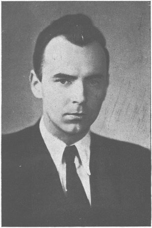

*Úvod knihy Písně radosti a mládí: umělecký vývoj a dílo Radima Drejsla, kterou napsal skladatel a muzikolog Jiří Válek (1923–2005) a v roce 1956 vydal Svaz československých skladatelů. Kniha vyšla tři roky po Drejslově smrti a pár měsíců po XX. sjezdu KSSS, na který předmluva naráží. Portrét je z frontispisu knihy.*

Se jménem Radima Drejsla se naše veřejnost důvěrněji seznámila v letech 1948–1949. Drejslovy písně se tehdy rozletěly po městech a vsích do nejzazších koutů naší vlasti, aby svou úsměvnou svěžestí, melodickou bohatostí a krásou vyloudily radost v srdcích lidí a zpěv na jejich rtech.

Mezi hudebníky byl už dříve Radim Drejsl znám jako jeden z nejtalentovanějších, umělecky nejprůbojnějších a nejpokrokovějších příslušníků naší mladé skladatelské generace. Nyní však už nešlo jen o mladého nadaného skladatele. Písně Radima Drejsla zněly jako poslové nového krásného jara naší vlasti.

Co bylo příčinou úspěchu těchto skladeb? V čem spočívá jejich invenční síla?

Naši novou vojenskou a budovatelskou píseň si dnes stěží dovedeme představit bez skladeb Radima Drejsla. A přece, je známo, že až do roku 1948 Drejsl masové písně nekomponoval. Veškeré své úsilí a tvůrčí zájem zaměřoval výlučně na komposici vážné, komorní a symfonické hudby. Co bylo příčinou, že Drejsl tak náhle změnil svůj umělecký postoj?

Drejsl až do roku 1948 užíval všech »vymožeností« nejmodernějších výrazových prostředků, t. zv. avantgardních hudebních směrů. Co způsobilo, že po roce 1948 změnil svůj umělecký postoj? Má tato změna hlubší kořeny? Představují Drejslovy písně a skladby, vytvořené po roce 1948, samostatnou, na předcházejícím období nezávislou tvůrčí epochu, nebo existuje nějaká užší souvislost mezi nimi a komorními a symfonickými skladbami, pocházejícími z doby dřívější?

Na všechny tyto a řadu dalších otázek nám může odpovědět pouze důkladný monografický rozbor Drejslova díla.

Za uplynulých 10 let vytvořili naši skladatelé poměrně bohatou tradici soudobé budovatelské i vojenské hudby, především pokud jde o nejrůznější žánry vokální hudební tvorby. Poslední dobou, zvláště po XX. sjezdu KSSS, se u nás vyskytly (i když ojediněle) názory, že by bylo nejlíp vyškrtnout toto období z naší hudební historie a začít znovu, líp, na důkladnějších základech. Není snad třeba podrobně dokazovat nesprávnost podobných »radikálních« názorů. Hodit přes palubu všechny dobré i špatné zkušenosti, které jsme v minulosti – a zvláště jde-li o minulost tak významnou, bezprostředně spjatou s naší současností – získali, nemůže přece za žádných okolností být ve prospěch dalšího vývoje naší hudby. Naopak, vzhledem k tomu, že se potřeby našeho lidu a tím i úkoly naší hudby *v podstatě* nemění a během našeho budování socialismu ani nemohou měnit, mohlo by takové počínání vést nanejvýš k tomu, že chyby, které jsme dělali v minulosti, bychom opakovali, a zkušeností, které byly v minulosti tak draze v praxi vykoupeny, bychom museli znovu pracně nabývat.

Drejsl prošel podobným vývojem jako převážná většina českých a slovenských skladatelů, kteří studovali a umělecky vyrostli v období před rokem 1948. Tím je Drejslův umělecký vývoj typický pro celou naši mladší skladatelskou generaci. Život, chyby, zkušenosti a úspěchy Radima Drejsla jsou do značné míry chybami, zkušenostmi a úspěchy celé soudobé české hudby. Jejich rozbor nám proto umožní stanovit některé zásady, platné obecně pro celou naši soudobou hudbu.

Drejslova nejlepší díla se však zároveň vyznačují neobyčejnou osobitostí, hloubkou a vášnivostí invence. Vydobyla si nejen obliby u československého lidu, ale ovlivnila i tvorbu českých i slovenských skladatelů a pronikla i daleko za hranice.

Podaří-li se nám vyzkoumat, v čem vězí tato osobitost Drejslovy tvorby a čeho je výrazem, bude mít toto zjištění význam nejen pro hodnocení tvorby Radima Drejsla, ale *pomůže nám ukázat přesněji i směr*, jakým by se měla ubírat soudobá česká a slovenská hudba na cestě k dalším úspěchům.

Je tu i řada dalších otázek, týkajících se významu písňové tvorby Radima Drejsla. Někteří kulturní a umělečtí pracovníci se domnívají, že Drejslovy písně jsou dnes již zastaralé, že nepřinášejí nic nového a že proto není záhodno zařazovat je do programu. Tito pracovníci se pokoušejí oblibu Drejslových písní u našeho lidu srovnávat s popularitou předválečných časových šlágrů. Někteří naši hudební skladatelé považují za vážný nedostatek, že Drejsl ve svých skladbách posledního období užíval tak jednoduchých výrazových prostředků atd. I na tyto otázky a problémy bych chtěl ve své monografii odpovědět.

Loni jsme vzpomínali desátého výročí osvobození Československé republiky Sovětskou armádou. Hodně se u nás od té doby změnilo. Změnilo se i vědomí mnoha lidí. Mnozí naši lidé jsou již hlavou i srdcem na cestě k socialismu. Někteří jen částí svého já, někteří vykročili jen váhavě, někteří se dosud drží starého. Úkolem našeho současného umění – a hudba při tom, jak dobře víme, zaujímá jedno z nejpřednějších míst – je bojovat o nového socialistického člověka. Drejsl se probil svou tvorbou do přední linie tohoto boje. Jeho umělecká dráha je po této stránce významným příkladem a vzorem všem našim skladatelům. I tuto skutečnost jsem měl při psaní studie na mysli.

Praha v červnu 1956  
Dr Jiří Válek

*Drejslovy písně na budovatel.cz: [Armádě zdar](/pisen.phtml/armade_zdar), [Rozkvetlý den](/pisen.phtml/rozkvetly_den), [Tankistům](/pisen.phtml/tankistum), [Voják úderník](/pisen.phtml/vojak_udernik), [Za Gottwalda vpřed!](/pisen.phtml/za_gottwalda_vpred).*
