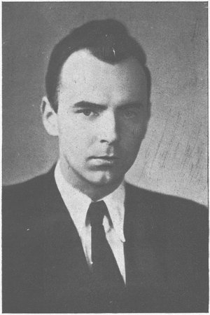
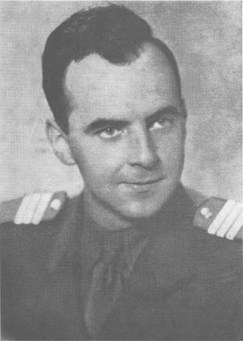
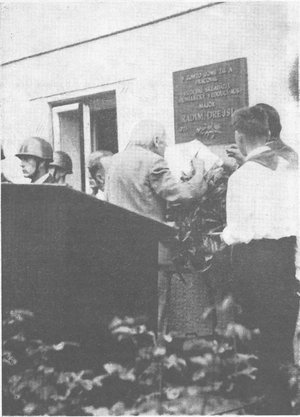

*Život a dílo autora písní Armádě zdar a Rozkvetlý den, sepsané pro budovatel.cz podle monografie Jiřího Válka Písně radosti a mládí: umělecký vývoj a dílo Radima Drejsla (Svaz československých skladatelů, 1956). Čísla v závorkách jsou strany knihy. [Předmluvu knihy](/state.phtml/predmluva_pisne_radosti_a_mladi) máme celou. Doplněno podle vzpomínkové brožury Jak jsme ho znali, kterou k Drejslovým nedožitým padesátinám vydal v roce 1973 Městský národní výbor v Dobrušce (dále JJHZ).*

**Dobruška (1923–1942).** Radim Zdeněk Jiří Drejsl se narodil 29. dubna 1923 v Dobrušce jako druhé dítě tkalcovského mistra Josefa Drejsla a Antonie, rozené Poláčkové; sestra Věra byla o dva a půl roku starší (s. 9–10). Otec zpíval a od roku 1930 předsedal pěveckému spolku Dobroš, politicky organizovaný nebyl (s. 10, 37). Od osmi let se Radim učil na klavír, později i na violoncello a teorii, v hudební škole dobrušského učitele Jaromíra Šenkýře (s. 12, 14). Měl mimořádnou hudební paměť a skládal už jako gymnazista v Rychnově nad Kněžnou, kde v roce 1942 maturoval s vyznamenáním (s. 11–16). Už v roce 1939 získal stipendium na studium ve francouzském Nîmes, nastoupit mu ale nedovolila válka (JJHZ).

**Konzervatoř a válka (1942–1945).** Chtěl studovat medicínu, vysoké školy však byly zavřené, a tak nastoupil na pražskou konzervatoř ke skladateli Janečkovi; klavír studoval u M. Knotkové a dirigování u P. Dědečka. Po uzavření konzervatoře v roce 1944 byli studenti nasazeni do pražské firmy Dorka (s. 16–17, 23). Pro otce psal duchovní a vlastenecké písně do dobrušského kostela (s. 23). Dne 22. dubna 1945 ostřelovali hloubkaři osobní vlak z Opočna do Prahy; Drejsl, který se vracel z přednášky o moderní hudbě v Dobrušce, dostal mezi Chlumcem a Velkým Osekem dvě střepiny do plic (s. 25–26; JJHZ). Během Pražského povstání mohl z Dobrušky poslat bojující Praze aspoň zásilku potravin (s. 25–26). Na podzim 1945 měl premiéru jeho dětský balet Černoušek a opička (s. 29–30).

**Avantgarda a obrat (1946–1948).** Od roku 1946 studoval skladbu na AMU u Pavla Bořkovce (s. 42). Psal komorní a klavírní hudbu v moderním duchu: klavírní sonáty, suity, Sonatinu pro flétnu (v prosinci 1948 vybranou na výměnný koncert s pařížskou konzervatoří), cyklus Krajiny dětství na verše Halase, Tomana a Dyka, Symfonii pro smyčce a Koncert pro klavír (s. 31–54, 161). Podle Válka ho Churchillův projev ve Fultonu přivedl ke komunistům; přihlášku do KSČ podal v dubnu 1947 (s. 39). Masové písně začal psát až po únoru 1948, pro Lidový soubor konzervatoře a pro dělnický sbor Stalinových závodů v Litvínově, se kterým pracoval jako sbormistr (s. 56–59).

**Rozkvetlý den (1949).** Píseň vznikla pro Lidový soubor konzervatoře; podle vzpomínek přátel ji Drejsl dodělával o prázdninách 1949 doma v Dobrušce, odkud jezdil na kole k rybníku Broumar a nápady si zapisoval, kam se dalo (JJHZ). Refrén Drejsla napadl rovnou s vlastním politickým textem, který se vysmíval Churchillovi a Marshallovu plánu (*„Dál, jsme už dál, o dvacet procent nad normál…“*). Dnešní text napsal po domluvě se skladatelem jeho spolužák Miloslav Zachata (s. 79–81). Ve stejném roce psal s etnografem Karlem Plickou taneční pásma pro Soubor československých národních písní a tanců a jel s Lidovým souborem konzervatoře do Bulharska (s. 62, 86).

**Armádní umělecký soubor (1949–1953).** Na podzim 1949 se přihlásil na místo uměleckého vedoucího Armádního uměleckého souboru Víta Nejedlého a ještě jako student ho dostal. Soubor, který tehdy hrál tři až čtyři představení denně a sám se živil, rozdělil na sbor, orchestr a taneční skupinu a dal mu program (s. 86–90). V návrhu prvního programu je i jeho píseň *S naší armádou*, první znění písně [Armádě zdar](/pisen.phtml/armade_zdar) (s. 167). AMU dokončil v roce 1950 s vyznamenáním; na konci roku narukoval a po základním výcviku se vrátil k souboru, který pak vedl jako štábní kapitán, nakonec major (s. 120, 126, 166; JJHZ). Fotografie z brožury ho ukazuje jako četaře v roce 1950. Obvykle skládal nejdřív melodii a jeho stálí textaři Miroslav Kroh a Miloslav Zachata k ní podle jeho pokynů psali slova; novou píseň hned zkoušel se souborem (s. 96, 112, 122). Tak vznikly [Sláva tankům](/pisen.phtml/tankistum) (1950), [Voják úderník](/pisen.phtml/vojak_udernik) (1950), Písnička na vojně, častušky Kandidát a Voják a sršeň, [Za Gottwalda vpřed!](/pisen.phtml/za_gottwalda_vpred) (1951) a Píseň o Fučíkovi, která dostala první cenu v soutěži mladých skladatelů (s. 162). V roce 1952 jel se souborem do Polska a do Číny (s. 163–166) a s Krohem začal psát operu o Janu Želivském, jejíž skici nakonec zničil (s. 152, 162–163).

**Smrt (1953).** Dne 17. března 1953 stál v čestné stráži u rakve Klementa Gottwalda. Od 26. března do 18. dubna byl s delegací Svazu československých skladatelů v SSSR; spolubydlící Miroslav Barvík vzpomíná, že si stěžoval na srdce a nespavost a trápil se kvůli dívce, se kterou se bál rozchodu (s. 166, 170–173). Ráno 20. dubna 1953, po probdělé noci, spáchal podle Válka sebevraždu (s. 154). Válek ji vysvětluje depresí a tím, že Drejsl kolem sebe neměl dost opravdových přátel. Pozdější tvrzení rodiny a režiséra Vojtěcha Jasného, že šlo o vraždu, se nikdy nepotvrdilo; vzpomínková brožura z roku 1973 způsob jeho smrti vůbec nezmiňuje. Několik posledních písní dokončili a otextovali po jeho smrti jiní: Píseň proudových stihačů, Země krásná (O. Flosman) a Za mír (text K. Šiktanc) (s. 94, 136–138).

**Pohřeb a památka.** Pohřeb byl 29. dubna 1953, v den, kdy by Drejsl oslavil třicáté narozeniny: rakev stála v pražském Domě umělců, odpoledne se konal obřad ve strašnickém krematoriu s čestnými salvami a jeho písněmi. Urna je uložena v urnovém háji Husova sboru v Dobrušce. Dne 5. září 1959 odhalil Zdeněk Nejedlý na domku Drejslových v Dobrušce pamětní desku, na fotografii vpravo. Dobrušská lidová škola umění nese Drejslovo jméno a rodiče a sestra Věra Marešová zachovali jeho pracovnu v původní podobě. Brožura ho uvádí jako laureáta státní ceny a odhaduje jeho dílo na asi 150 skladeb (JJHZ).

**Vojenské a budovatelské písně podle Válkova soupisu** (s. 175–179, textaři v závorce):

- 1948–1949: Znělka agitky filosofické fakulty, Dožínková (Drejsl), Vlaj, naše vlajko (J. Hájek), Hymna STM, Jdem a jdem (pásmo Pětiletka, M. Zachata), [Rozkvetlý den](/pisen.phtml/rozkvetly_den) (M. Zachata)
- 1950: [Armádě zdar](/pisen.phtml/armade_zdar) (M. Zachata), [Sláva tankům](/pisen.phtml/tankistum) (M. Kroh), Husitský zpěv (J. Rodr a M. Kroh), Přísaha míru (M. Zachata), [Voják úderník](/pisen.phtml/vojak_udernik) (M. Kroh)
- 1951: Písnička na vojně, Kandidát, Voják a sršeň (všechny M. Kroh), Ukolébavka (M. Zachata), kantáta Sláva mé zemi (M. Zachata), Byla jsem s milým v hájině, [Za Gottwalda vpřed](/pisen.phtml/za_gottwalda_vpred) (M. Zachata), Píseň o Fučíkovi (M. Zachata)
- 1952: Štěstí (M. Kroh), hudba ke Kohoutově hře Dobrá píseň, Dopis vojákovi (M. Kroh), Píseň o Stalinovi (M. Kroh), Den na letišti a Píseň bitevních letců (M. Zachata), Píseň československo-čínské družby, Kantáta o vrchním veliteli (S. Neumann), Čtyři vojáci (M. Kroh), Za mír (K. Šiktanc), Dopis na hranici a Píseň nad dítětem (S. Neumann), Píseň kulometných čet (P. Kohout), Ve jménu Jana Žižky (M. Kroh), Země krásná (M. Zachata), Píseň o snu jednoho šoféra (J. Štuka a M. Kroh)
- 1952–1953: Hihi 4 (Š. Ladižinský, česky P. Kohout), Častuška o nejmilejších (P. Kohout)

Na gramofonové desky (Armádní diskotéka a Supraphon, 1950–1953) natočil Armádní umělecký soubor mimo jiné Rozkvetlý den, Armádě zdar, Tankistům, Vojáka úderníka, Písničku na vojně, Kandidáta, Píseň o Fučíkovi a Za Gottwalda vpřed (s. 182–183). Souborně vyšly Drejslovy písně v říjnu 1956 v Repertoárním sborníku Ústředního domu armády č. 22 *Písně Radima Drejsla* (s. 181).
