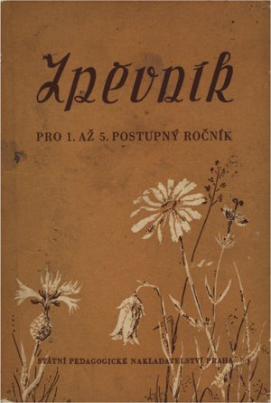

*Krátký úvod „autorů“ ze školního zpěvníku, který sestavili Alois Šebestík a Miroslav Krčma a ve 2. vydání v lednu 1955 vydalo Státní pedagogické nakladatelství v Praze (vedoucí redaktor Rudolf Turek, obálka Antonín Hachle; cena brožovaného výtisku 2,40 Kčs). Zpěvník začínal hymnami, další písně byly seřazeny podle ročníků; vedle lidových písní obsahoval řadu písní pionýrských, budovatelských a sovětských.*

*V tomto zpěvníku najdete řadu písní, které znáte, ale i mnoho těch, kterým se teprve budete učit.*

*Jsou to většinou písně lidové, které vznikaly při práci, při zábavě, při různých veselých nebo smutných příhodách a událostech v životě lidí.*

*Seznámíte se s písněmi jiných slovanských národů, zejména národů Sovětského svazu.*

*Melodie některých jsou jásavé a radostné, jiné vyjadřují odhodlání a bojovnost. Nechybějí však ani vážné a slavnostní písně, které se zpívají jen při zvláštních příležitostech. Mezi ně patří i hymny, kterým se postupně naučíte, abyste je dovedli zpívat co nejlépe.*

*Za hymnami jsou ostatní písně seřazeny podle toho, ve kterém postupném ročníku se jim budete učit. K těm, které se vám budou obzvláště líbit, se jistě vrátíte i v pozdějších letech. Doučíte se k nim druhému hlasu a dáte si mnohem více záležet na pěkném přednesu.*

*Zpěvník bude vaším dobrým pomocníkem i mimo školu. Pomůže vám zlepšit práci pěveckých zájmových kroužků i pionýrských skupin.*

AUTOŘI

## Jak zpěvník přijali učitelé

Zpěvník vyšel poprvé v roce 1954 (2. vydání 1955, další 1956–1958) a ministerstvo školství ho schválilo jako pomocnou knihu; zpracovali ho Alois Šebestík a Miroslav Krčma, rukopis posoudili Karel Jüngling, Josef Straka, Vilém Schmitt a Felix Zrno. Učitelé ho netrpělivě čekali – Hudební výchova v březnu 1954 citovala dopis, že „národ muzikantů a zpěváků nemůže přec vychovávat svou mládež… bez zpěvníku“, protože starší zpěvníky byly rozebrány.

Felix Zrno v recenzi v časopise Komenský (1954) ocenil, že vedle lidových písní obsahuje „umělé písně naše i jiné, hlavně sovětské“, většinou pracovní a budovatelské, vybrané tak, aby se tónovým rozsahem hodily pro děti, a doufal, že žáci přinesou „smysl pro hudební krásno, které najisto není v odkřičovaných pochodových písních“.

Praxe byla střízlivější. Marie Vošlajerová v Hudební výchově (1957) shrnula, že jedni učitelé byli rádi, že „mají z čeho zpívat“, jiní se ptali, kdo písně vybíral, když se „nedají zpívat“; Hudební výchova 1958 vytýkala, že ve zpěvníku pro nejmenší není jediná píseň v rozsahu tercie. A zpráva v Estetické výchově z roku 1959 konstatovala, že ve škole „naprosto převládají lidové písně“, zatímco umělé písně, i ty předepsané osnovami, „nezískaly u žáků ani učitelů oblibu a nezpívají se“.

*Zdroje: Komenský 1954, s. 39, 284, 555–556; Hudební výchova 3/1954, 11/1957, 5/1958; Estetická výchova 7/1959; Věstník ministerstva školství 1954–1959 – v České digitální knihovně.*

## Písně ze zpěvníku na webu

[Brigádníci](/pisen.phtml/brigadnici), [Co hájíme, co střežíme](/pisen.phtml/co_hajime_co_strezime), [Dal příkaz soudruh Stalin](/pisen.phtml/dal_prikaz_soudruh_stalin), [Ivan](/pisen.phtml/ivan), [K 1. máji](/pisen.phtml/k_1_maji_sebestik), [Letadlo](/pisen.phtml/letadlo), [Letci](/pisen.phtml/letci), [Maminkám](/pisen.phtml/maminkam), [Májová](/pisen.phtml/majova_smatek), [Májová](/pisen.phtml/majova_kadosa), [Na brigádu](/pisen.phtml/na_brigadu), [Naše mámy](/pisen.phtml/nase_mamy), [Neseme válku ze vsi](/pisen.phtml/neseme_valku_ze_vsi), [O Péťovi](/pisen.phtml/o_petovi), [Pionýrská pochodová](/pisen.phtml/pionyrska_pochodova_starokadomskij), [Pionýrská pochodová](/pisen.phtml/pionyrska_pochodova_grossman), [Pionýrský šátek](/pisen.phtml/pionyrsky_satek), [Píseň brigády](/pisen.phtml/pisen_brigady), [Píseň letce](/pisen.phtml/pisen_letce), [Píseň nejšťastnějších](/pisen.phtml/pisen_nejstastnejsich), [Píseň o Leninovi](/pisen.phtml/pisen_o_leninovi_levina), [Píseň továrny](/pisen.phtml/pisen_tovarny), [Píseň zemědělské brigády](/pisen.phtml/pisen_zemedelske_brigady), [Písnička panu presidentovi](/pisen.phtml/pisnicka_panu_presidentovi), [Pochod](/pisen.phtml/pochod_kljacko), [Pochod rudých námořníků](/pisen.phtml/pochod_rudych_namorniku), [První máj](/pisen.phtml/prvni_maj), [Přátelé](/pisen.phtml/pratele), [Říjnová](/pisen.phtml/rijnova), [Slavný den](/pisen.phtml/slavny_den), [Sovětští vojáci](/pisen.phtml/sovetsti_vojaci), [Stavíme domy](/pisen.phtml/stavime_domy), [Strojvůdcova písnička](/pisen.phtml/strojvudcova_pisnicka), [Tramvaj](/pisen.phtml/tramvaj), [Válka! Válka!](/pisen.phtml/valka_valka), [Vždy buď připraven](/pisen.phtml/vzdy_bud_pripraven).
